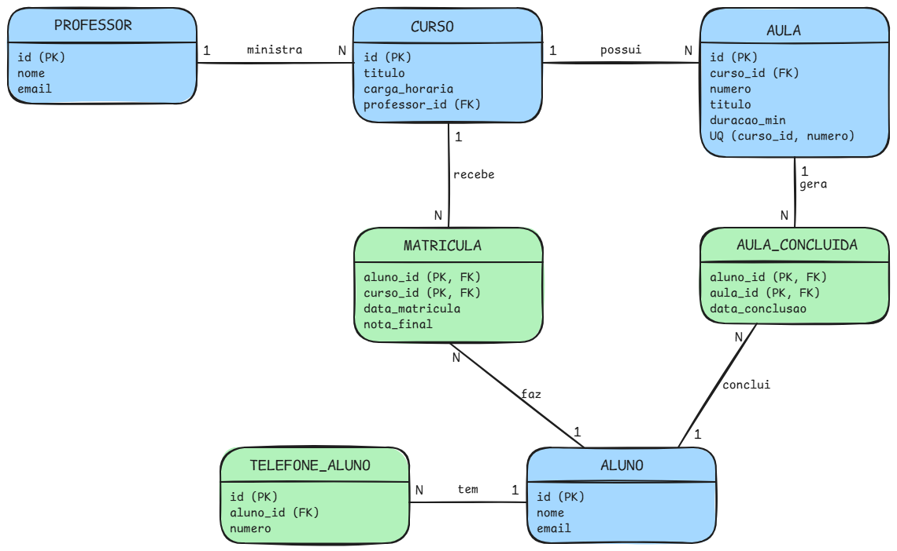

# Modelagem plataforma de cursos

Exercicio do Modulo 2, Aula 1: modelagem relacional, cardinalidade e normalizacao.

O modelo representa uma plataforma de cursos online com professores, cursos, aulas e alunos. O aluno se matricula em cursos e vai marcando as aulas que concluiu.

## DER

Azul sao as entidades principais e verde as tabelas que surgiram do N:N ou da normalizacao.

## Tabelas

| Tabela | Chave | Observacao |
|---|---|---|
| PROFESSOR | id | |
| CURSO | id | professor_id (FK) |
| AULA | id | curso_id (FK), numero unico por curso |
| ALUNO | id | |
| TELEFONE_ALUNO | id | aluno_id (FK), saiu da 1FN |
| MATRICULA | aluno_id + curso_id | resolve o N:N entre aluno e curso |
| AULA_CONCLUIDA | aluno_id + aula_id | resolve o N:N entre aluno e aula |
